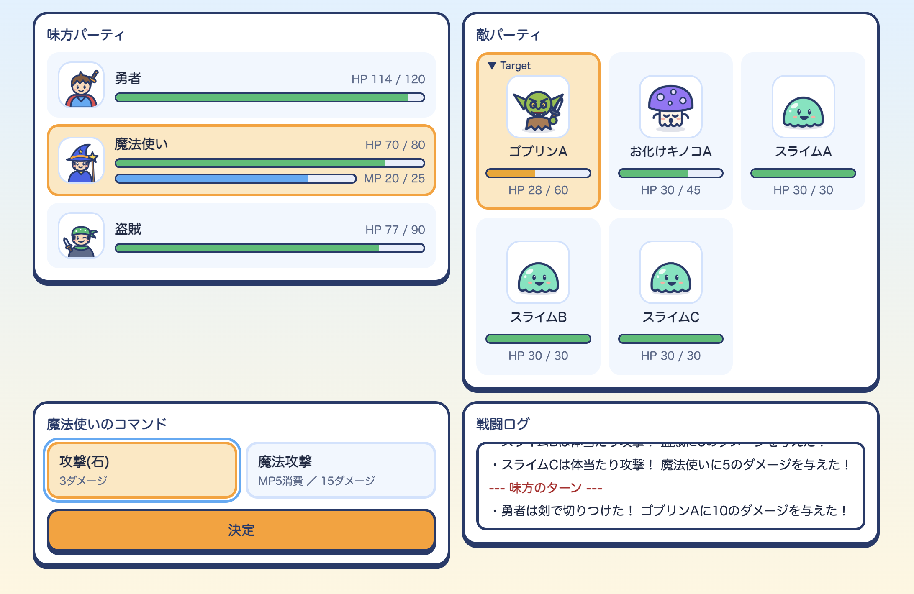

# RPG Battle（Java Servlet / JSP）

勇者・魔法使い・盗賊のパーティで、ランダムに出現する5体の敵と戦うターン制RPGです。
授業で作成したコンソール版のオブジェクト指向課題を、Webアプリケーションとして作り直しました。


## 遊び方

1. タイトル画面で「ゲーム開始」を押す
2. キャラクターごとに行動と攻撃対象（敵カード）を選ぶ
3. 全員が行動すると敵のターン。敵を全滅させれば勝利、味方が全滅すると敗北

| 職業 | 通常行動 | 特殊行動 |
| --- | --- | --- |
| 勇者 | 剣で攻撃（10ダメージ） | スーパーヒーローに変身（HP-30、以後の攻撃が2.5倍の25ダメージ） |
| 魔法使い | 石を投げる（3ダメージ） | 魔法攻撃（MP5消費、15ダメージ） |
| 盗賊 | 短剣で2回攻撃（6×2＝12ダメージ） | 守る（次に受ける攻撃を1回無効化） |

## 使用技術

- Java 17 / Jakarta Servlet 6.0 / JSP・JSTL 3.0
- Apache Tomcat 10.1
- Maven / JUnit 5
- HTML / CSS / JavaScript（フレームワークなし）

## 構成

```
src/main/java
├── controller/   … Servlet（リクエストの受付と画面遷移だけを担当）
├── creature/     … キャラクター・モンスターの共通クラスとインターフェース
│   ├── character/   勇者・スーパーヒーロー・魔法使い・盗賊
│   └── monster/     ゴブリン・お化けキノコ・スライム
└── weapon/       … 武器（剣・短剣・魔法の杖）
src/main/webapp
├── WEB-INF/jsp/  … 画面（JSP）。味方・敵の表示は fragments/ に部品化
├── css/  js/
```

| URL | メソッド | 役割 |
| --- | --- | --- |
| `/start` | GET | パーティと敵を生成してセッションに保存 |
| `/select` | GET | 行動選択画面の表示 |
| `/battle` | POST | 1人分の行動と、必要なら敵のターンを処理 |
| `/end` | GET | 勝敗の表示とセッションの破棄 |

## 設計で工夫した点

- **MVCの分離**：ドメインクラスはHTMLを持たず、Servletは状態の受け渡し、表示はJSPが担当します。
- **サーバー側の状態を正とする**：行動中のキャラはセッションで管理し、クライアントから送られた値は使いません。攻撃対象の番号も範囲を検証してから使います。
- **PRGパターン**：状態を変える処理はPOSTで受け、処理後にリダイレクトします。リロードしても行動が二重に実行されません。
- **XSS対策**：画面に出す名前やログは `<c:out>` でエスケープしています。
- **JavaScriptがなくても動く**：JSは「対象を選ばない行動のときに敵カードを無効化する」「二重送信を防ぐ」などの補助だけに限定しています。
- **アクセシビリティとレスポンシブ対応**：ラジオボタンを使ったカード選択、キーボード操作時のフォーカス表示、スクリーンリーダー向けのラベル、スマホでは敵→味方→コマンドの順に並べ替え。

## 実行方法

1. JDK 17 以上と Tomcat 10.1 を用意する
2. プロジェクトのフォルダで WAR を作成する（Maven のインストールは不要。初回のみ Maven が自動でダウンロードされます）
   - Mac / Linux：`./mvnw package`
   - Windows：`mvnw.cmd package`
3. `target/rpg-battle-1.0-SNAPSHOT.war` を Tomcat の `webapps/` に配置し、`http://localhost:8080/rpg-battle-1.0-SNAPSHOT/` を開く

IntelliJ IDEA の場合は、Tomcat の Run Configuration に WAR exploded を追加して実行できます。

テストの実行：`./mvnw test`（Windows は `mvnw.cmd test`）

## 今後の改善

- 戦闘の進行ロジックを Servlet から専用クラスに切り出し、JUnit でテストできるようにする
- 職業ごとの分岐（`instanceof`）を、各キャラクターが自分の行動を持つ形に置き換える
- 画面に表示しているダメージ量などの数値を、武器クラスの値から取得する
